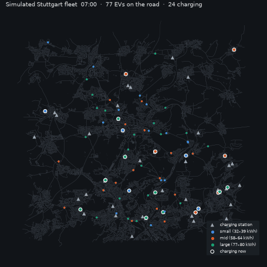
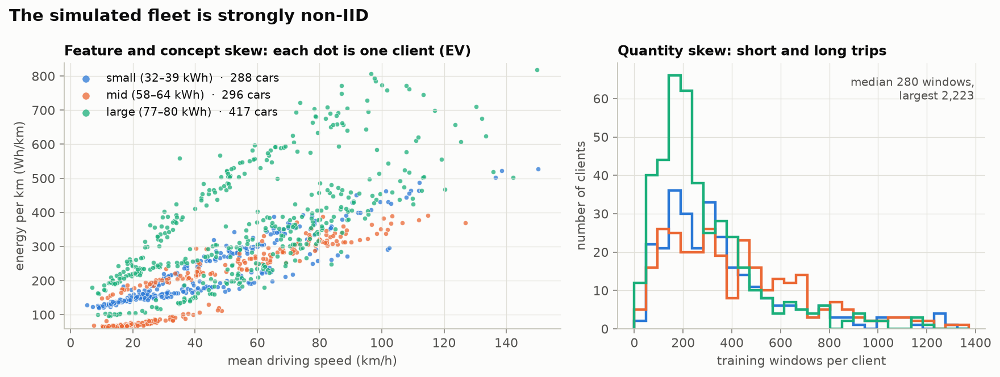
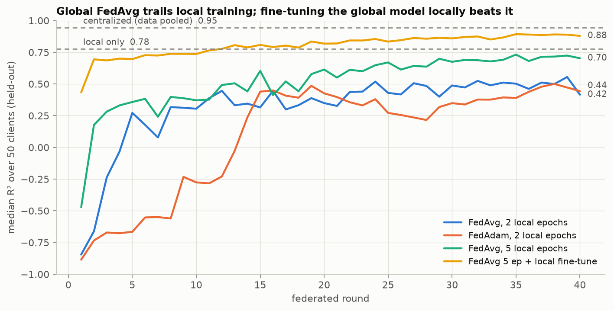
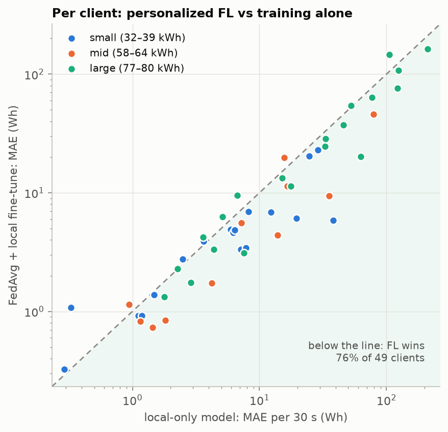
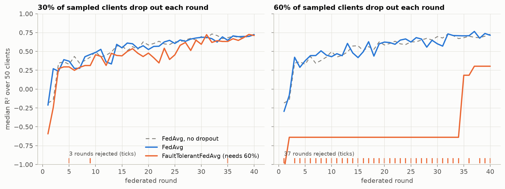
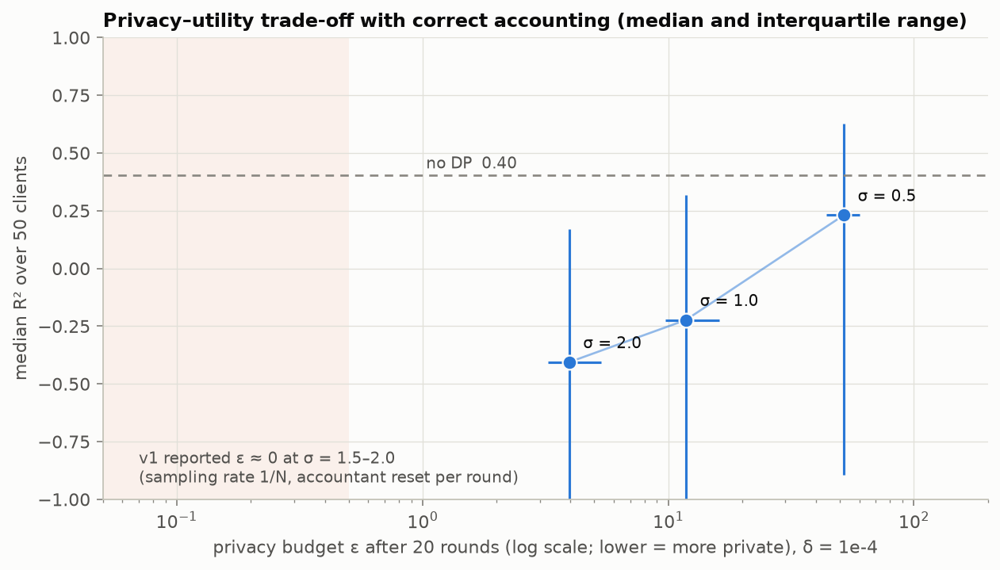
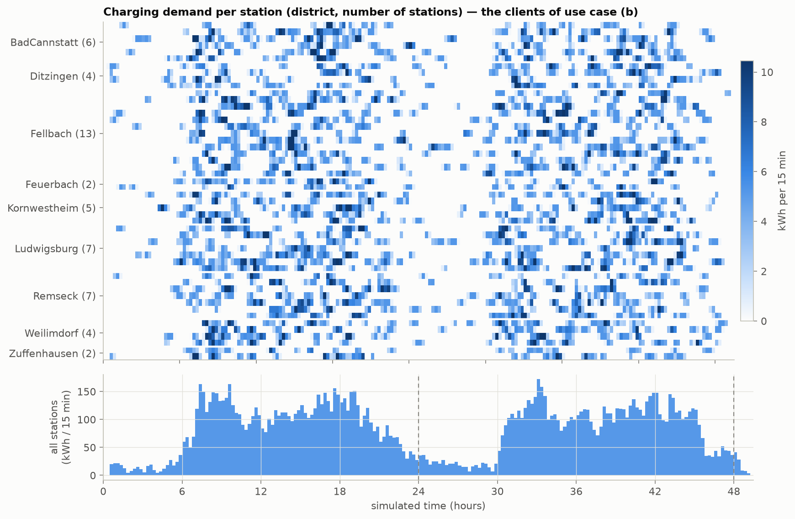
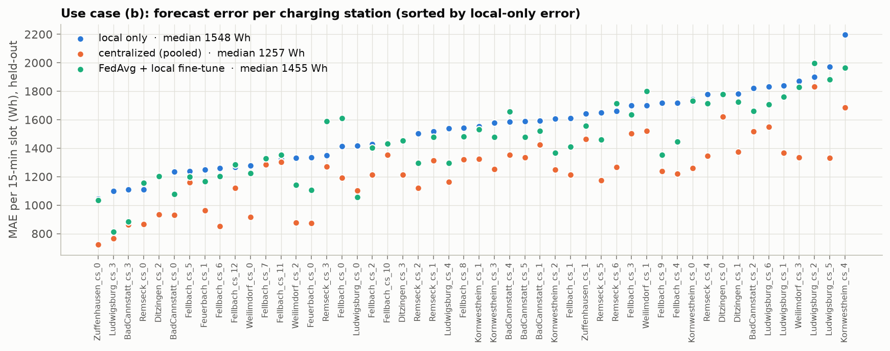

# Federated learning for simulated EV fleets

Federated learning (FL) on a simulated electric-vehicle fleet in Stuttgart. Each car and each charging
station trains on its own data, and only model weights leave the device.

This is **v2** of the code from my master thesis,
*"Towards Production-ready End-to-end Federated Learning for Automotive Applications"*
(University of Stuttgart, 2022, [public record](https://elib.uni-stuttgart.de/items/1d446a31-e467-4197-8ac2-7fa6e222ee99)),
which Flower features on its [automotive page](https://flower.ai/industries/automotive).
The original code is preserved unchanged at tag [`v1.0-thesis`](../../tree/v1.0-thesis).



All data is **simulated** with [SUMO](https://eclipse.dev/sumo/) on OpenStreetMap roads. No real vehicle data is used.

## What it does

| | Use case (a): EVs | Use case (b): charging stations |
|---|---|---|
| Client | one simulated EV (7 models, ~1,000 cars) | one charging station (50 × 22 kW) |
| Task | energy needed for the next 30 s of a planned speed profile → remaining battery capacity | energy delivered in the next 15 min |
| Model | 1-layer LSTM, 32 units | 1-layer LSTM, 32 units |
| Baselines | local-only, centralized | local-only, centralized |

Built on **Flower 1.42** (Message API, simulation runtime on Ray), **PyTorch** and **Opacus**.

## Quickstart

```bash
python -m venv .venv && source .venv/bin/activate
pip install -e ".[dev,viz]"

# 1. Simulate the data (needs SUMO: brew install sumo / apt install sumo)
python scenario/build.py --out data                                   # EVs, ~10 min
python scenario/build.py --out data/cs --end 172800 --period 50 \
       --charge-fraction 0.5 --no-battery-output --daily-profile      # charging stations, 2 days

# 2. One federated run
python -m evfl.run --kind ev --num-clients 50 --rounds 40 --local-epochs 5 --finetune-epochs 5

# 3. Everything behind the results below, then the tables
bash scripts/experiments.sh && python scripts/summarize.py
```

## Results

Full tables: [docs/results.md](docs/results.md); figures from `python scripts/figures.py`. One seed per
run, so treat differences of a few hundredths in R² as noise.

### The fleet is strongly non-IID



Seven EV models with different mass, drag and power give clients with clearly different
energy behaviour (left; the large class even splits into two clusters, the SUV vs the ID.4/EV6), and
trip lengths make the amount of data per client vary by more than 10× (right).

### Federated vs local vs centralized

| Model (50 EV clients, held-out data) | Median R² | Median error per 30 s stretch |
|---|---|---|
| Centralized (all data pooled; not private) | 0.945 | 4.3 Wh |
| **FedAvg + local fine-tuning** | **0.879** | **5.6 Wh** |
| Local only | 0.778 | 7.5 Wh |
| FedAvg, global model only | 0.70–0.73 | 11.5–12.2 Wh |





### Client dropout



| 50 EV clients, 40 rounds | Median R² | Rounds that updated the model |
|---|---|---|
| FedAvg, no dropout | 0.728 | 40/40 |
| FedAvg, 30% / 60% dropout | 0.723 / 0.714 | 40/40 |
| FaultTolerantFedAvg (needs 60% to report), 30% dropout | 0.711 | 37/40 |
| FaultTolerantFedAvg (needs 60% to report), 60% dropout | 0.303 | **3/40** |

### Differential privacy, with correct accounting



| Noise σ (client-side DP-SGD, 20 rounds, clip 1.0, δ = 10⁻⁴) | Median R² | Median ε (worst client) |
|---|---|---|
| 0 (no DP) | 0.40 | – |
| 0.5 | 0.23 | 52 (88) |
| 1.0 | −0.22 | 12 (26) |
| 2.0 | −0.41 | 4 (12) |

### Use case (b): charging-station demand



Demand follows the daily traffic profile (quiet nights, morning and evening peaks) and differs strongly
between areas, so the 50 stations are non-IID too.

| 50 stations, held-out data | Median R² | Median error per 15-min slot |
|---|---|---|
| Centralized (all data pooled; not private) | 0.50 | 1,257 Wh |
| **FedAvg, global model** | **0.43** | **1,432 Wh** |
| FedAvg + local fine-tuning | 0.38 | 1,455 Wh (better than local-only for 80% of stations) |
| Local only | 0.38 | 1,548 Wh |



### What the results say

- **A shared global model alone is not enough for a non-IID fleet.** FedAvg's global model trails each
  car training alone (0.70 vs 0.78 median R²), although one centralized model fits all cars well
  (0.945), so the gap is in the optimization, not in model size.
- **Personalization closes most of the gap.** Fine-tuning the global model on each car's own data (the
  fine-tuned copy never leaves the car) beats local-only training for 76% of cars and gets within
  ~1.3 Wh of the centralized model.
- **More local work matters more than a server optimizer here.** Going from 2 to 5 local epochs moved
  the global model from 0.42 to 0.73. FedAdam at the tried server learning rate did not help (0.44).
- **Random dropout barely hurts FedAvg.** Losing 30% or 60% of the sampled clients each round is like
  sampling fewer clients: 0.728 → 0.723 → 0.714.
- **FaultTolerantFedAvg is a safety gate, not an accuracy booster.** It refuses to update the model when
  too few clients report back. At 60% dropout with a 60% requirement it rejected 37 of 40 rounds and
  the model barely trained. It earns its place when dropout is *biased* (for example, one vehicle type
  going offline together), where averaging the survivors would skew the model; with random dropout it
  only slows training. (v1 claimed it "outperforms FedAvg"; it was never compared.)
- **Privacy is expensive at this data size.** Each car has a few hundred training windows. Single-digit
  ε needs σ ≥ 2, and by then the model is worse than predicting the mean.
- **Personalization is not automatically better.** For charging stations the plain global FedAvg model
  wins (1,432 vs 1,455 Wh for the fine-tuned one): each station has only ~130 training windows, so
  fine-tuning overfits, while the EVs have more data each and far more heterogeneous physics.
- **Station demand is only partly predictable from the last hour.** Arrivals are random; even the
  centralized model reaches a median R² of 0.50. Time-of-day features are the obvious next step.

## v1 → v2: what changed and why

A code review of v1 for this rework found problems that affected the thesis results. v2 fixes each one,
and [`tests/test_v1_regressions.py`](tests/test_v1_regressions.py) pins the fixes.

| Area | v1 (2022) | v2 |
|---|---|---|
| **DP accounting** | Sampling rate passed as 1/N while training full-batch (true rate 1.0); accountant reset every round. Reported ε "near zero" at σ = 1.5–2.0. | Opacus 1.x, Poisson sampling, mini-batches, RDP accountant carried across rounds in the client state. ε = 4–12 at σ = 2–1. |
| **EV task** | Target (remaining capacity) was close to a linear function of an input (cumulative energy); "LSTM" saw sequences of length 1. | Real 60-step sequences; no cumulative input; the future energy is the target, never an input. |
| **Charging-station evaluation** | Evaluated on the full series, training part included. | Chronological split with a gap; only the held-out part is scored. |
| **Charging-station energy** | Summed `partialCharge`, a running total per session, which overcounts. | Per-step `energyCharged`. |
| **Charging-station data** | Cars only charged while driving over a 10 m station (~1 s per pass). | Half of the trips detour to a charger and park there for 10–45 min (off the lane, so they don't block traffic); departures follow a daily profile with rush hours; stations are named after places inside the simulated area. |
| **Baselines** | Local only. | Local and centralized, on identical splits. |
| **Fault tolerance** | Failures came from an `UnboundLocalError`; never compared with FedAvg. | Explicit failures, seeded dropout injection, head-to-head comparison. |
| **Aggregate metric** | Sample-weighted mean of per-client R² (one bad client dominates). | Medians and share of clients above a threshold. |
| **Data** | 6-row sample in the repo; network and a loader module missing. | `scenario/build.py` regenerates everything from OSM in one command. |
| **Engineering** | Flower 1.0, hard-coded paths and client IDs, no tests. | Flower 1.42 Message API, CLI config, tests, CI. |

## Repository layout

```
scenario/build.py      OSM → SUMO → per-step CSVs for both use cases
scenario/render.py     the fleet animation above (headless SUMO, no GUI needed)
src/evfl/data.py       per-client windows, fixed scaling, chronological splits
src/evfl/model.py      LSTM forecaster (DPLSTM when DP is on)
src/evfl/train.py      training, DP-SGD with cross-round accounting, metrics
src/evfl/strategy.py   FedAvg/FedAdam with per-client bookkeeping, FaultTolerantFedAvg port
src/evfl/apps.py       Flower ServerApp and ClientApp
src/evfl/run.py        one experiment in the simulation runtime
src/evfl/baselines.py  local-only and centralized baselines
scripts/               all experiments, results tables
tests/                 regression tests for the v1 flaws
```

## Limitations

- **Simulated data.** SUMO's energy model uses constant efficiencies and no battery ageing or temperature.
  The results are about the FL system, not about real battery behaviour.
- **Single machine.** Clients run in Flower's simulation runtime, so network delay and heterogeneous
  hardware are not modelled. A Kubernetes deployment with real gRPC between server and clients is next.
- **One seed per configuration**, 50 clients per experiment on an 8-core laptop.

## What AI helped with, and what it did not

v2 was built with an AI coding assistant (Claude Code).

**It helped with:** reviewing the 2022 code and thesis side by side and finding the flaws in the table
above; porting to Flower's current API; writing the SUMO pipeline, tests and experiment scripts.

**It did not replace judgment.** Several of its own first attempts were wrong and were caught only by
looking at results critically: the first v2 EV task was unlearnable (even a centralized model scored
below zero); the first dropout experiment also dropped clients at evaluation time, so runs were scored
on different subsets; and an early metric aggregation let one client dominate. The decisions about
what to measure, which comparisons are fair, and what the numbers mean stayed with me.

## Citation

> S. Lakshmana Murthy, *Towards Production-ready End-to-end Federated Learning for Automotive Applications*,
> Master thesis, University of Stuttgart, 2022.

## License

[Apache-2.0](LICENSE). Map data © OpenStreetMap contributors ([ODbL](https://www.openstreetmap.org/copyright)).
